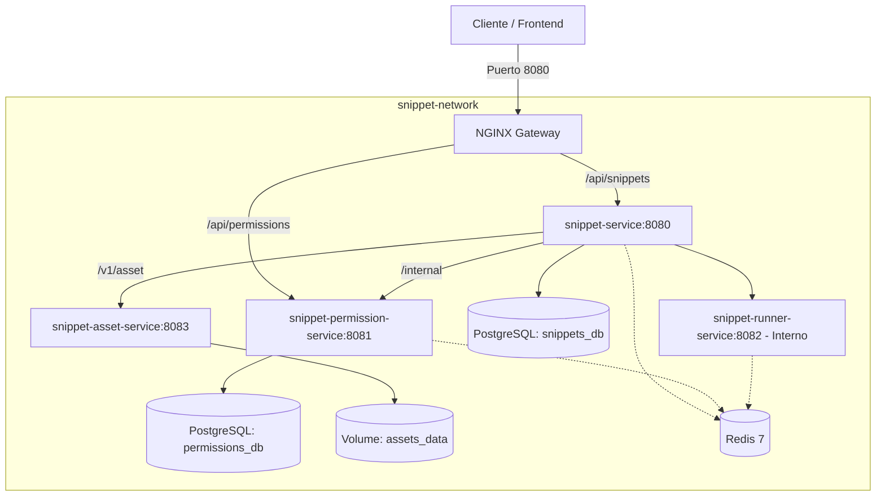

# snippet-infra

Repositorio de infraestructura, configuración de Docker Compose y Reverse Proxy NGINX para **Snippet Playground (TP2)**.

## Topología del Stack



## Servicios Orquestados

1. **`snippets-db`**: PostgreSQL 16 para metadata de snippets, estados y test cases (`snippets_db`).
2. **`permissions-db`**: PostgreSQL 16 para ownership, compartir y configuraciones de reglas de linteo/formateo (`permissions_db`).
3. **`redis`**: Redis 7 para colas y streams de eventos de reprocesamiento asincrónico.
4. **`snippet-service`**: Microservicio Spring Boot de metadata y test cases.
5. **`snippet-permission-service`**: Microservicio Spring Boot de usuarios, ownership y reglas.
6. **`snippet-runner-service`**: Microservicio aislado con el motor de PrintScript (sin puertos expuestos al host).
7. **`snippet-asset-service`**: Microservicio de almacenamiento de archivos de código.
8. **`gateway`**: NGINX Reverse Proxy. Rutea solo `/api/snippets`, `/api/permissions` y la UI; responde `403` a `/runner`, `/internal` y `/v1/asset`, que son rutas de servicio a servicio.

## Requisitos Previos

- Docker Engine (versión 24+) y Docker Compose (`docker compose` v2).
- Java 21 & Gradle (para compilar los microservicios backend Spring Boot).

## Pasos para Ejecución Local

### 1. Compilar los JARs de los microservicios backend

Los Dockerfiles de los microservicios Spring Boot (`snippet-service`, `snippet-permission-service`, `snippet-runner-service`, `snippet-asset-service`) utilizan imágenes de ejecución livianas (`eclipse-temurin:21-jre-alpine`) que empaquetan el artefacto compilado `build/libs/app.jar`.

Para compilar todos los microservicios con un solo paso:

```bash
./build-all.sh
```

### 2. Configurar Variables de Entorno (Opcional)

Si necesitas sobreescribir la configuración de autenticación Auth0:

```bash
cp .env.example .env
```

### 3. Levantar el Stack Completo

```bash
docker compose up --build
```

El Gateway NGINX quedará accesible en:
- **Frontend Web**: [http://localhost:8080](http://localhost:8080)
- **API Snippets**: [http://localhost:8080/api/snippets](http://localhost:8080/api/snippets)
- **API Permissions**: [http://localhost:8080/api/permissions](http://localhost:8080/api/permissions)
- **Gateway Health**: [http://localhost:8080/health](http://localhost:8080/health)

### 4. Detener el Stack

```bash
docker compose down
```

Para reiniciar borrando volúmenes de persistencia:

```bash
docker compose down -v
```

## Cumplimiento de Decisiones de Cátedra (ADRs)

- **D7 (Aislamiento del runner)**: `snippet-runner-service` se ejecuta estrictamente dentro de la red interna de Docker `snippet-network` sin exponer puertos al host ni a través del NGINX gateway. NGINX rechaza con `403 Forbidden` cualquier solicitud a `/runner`.
- **D8 (API interna de permisos)**: los endpoints que aceptan un `userId` explícito (`/internal/permissions`, `/internal/rules`) y el storage de assets (`/v1/asset`) solo se alcanzan desde la red interna; NGINX los bloquea con `403`.
- **Producción Frontend React**: `snippet-ui` utiliza un build de producción multi-stage empaquetado y servido a través de `nginx:1.27-alpine` (el uso de `devServer` o `npm run dev` está prohibido por la cátedra).
- **Streams Asincrónicos**: Los microservicios se conectan a Redis en el puerto `6379` sobre la red interna para procesamiento desacoplado de validación y linting.

