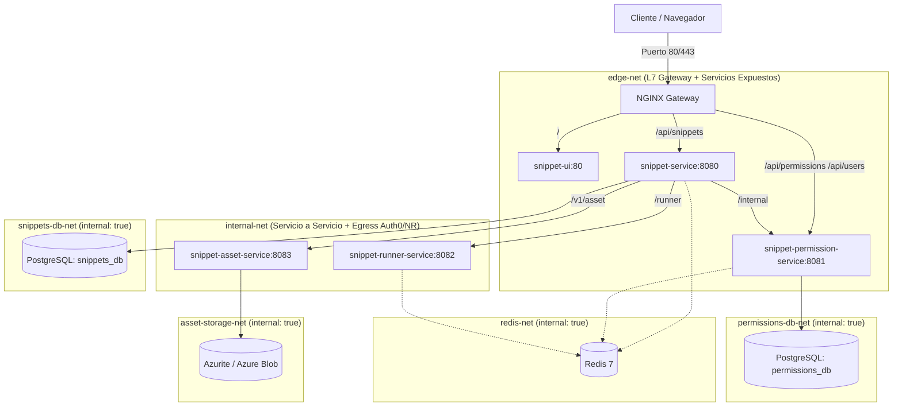

# snippet-infra

Repositorio de infraestructura, configuración de Docker Compose y Reverse Proxy NGINX para **Snippet Playground (TP2)**.

## Topología del Stack



## Servicios Orquestados

1. **`snippets-db`**: PostgreSQL 16 para metadata de snippets, estados y test cases (`snippets_db`).
2. **`permissions-db`**: PostgreSQL 16 para ownership, compartir y configuraciones de reglas de linteo/formateo (`permissions_db`).
3. **`redis`**: Redis 7 para colas y streams de eventos de reprocesamiento asincrónico.
4. **`snippet-service`**: Microservicio Spring Boot de metadata y test cases.
5. **`snippet-permission-service`**: Microservicio Spring Boot de usuarios (directorio para compartir), ownership y reglas.
6. **`snippet-runner-service`**: Microservicio aislado con el motor de PrintScript (sin puertos expuestos al host). Exige JWT en todas sus rutas: solo lo alcanza `snippet-service` con el token M2M, así que el stack necesita `AUTH0_M2M_ENABLED=true` para crear o ejecutar snippets.
7. **`snippet-asset-service`**: servicio provisto por la cátedra (fork en `IngsisMac/snippet-asset-service`; la implementación propia anterior quedó en la rama `custom-local`). Guarda el contenido crudo de cada snippet en Azurite (`AZURE_HOST`).
8. **`gateway`**: NGINX Reverse Proxy. Rutea solo `/api/snippets`, `/api/permissions`, `/api/users` y la UI; responde `403` a `/runner`, `/internal` y `/v1/asset`, que son rutas de servicio a servicio.

## Requisitos Previos

- Docker Engine (versión 24+) y Docker Compose (`docker compose` v2).
- Java 21 & Gradle (para compilar los microservicios backend Spring Boot).

## Pasos para Ejecución Local

### 1. Compilar los JARs de los microservicios backend

Los Dockerfiles de los microservicios Spring Boot (`snippet-service`, `snippet-permission-service`, `snippet-runner-service`, `snippet-asset-service`) utilizan imágenes de ejecución livianas (`eclipse-temurin:21-jre-alpine`) que empaquetan el artefacto compilado `build/libs/app.jar`.

Para compilar todos los microservicios con un solo paso:

```bash
./build-all.sh
```

### 2. Configurar Variables de Entorno (obligatorio)

Los backends validan los JWT de Auth0 contra el tenant y la audience configurados, así que
hace falta un `.env` antes de levantar el stack:

```bash
cp .env.example .env
```

Completar `AUTH0_ISSUER_URI` y `AUTH0_AUDIENCE`. Para que `snippet-service` llame a
`permission-service` y `runner-service` con token propio, poner `AUTH0_M2M_ENABLED=true` y las
credenciales de la Application machine-to-machine de Auth0.

### 3. Levantar el Stack Completo

```bash
docker compose up --build
```

> `--build` reconstruye las imágenes, pero **no recompila Kotlin**: cada Dockerfile copia el
> `build/libs/app.jar` que ya existe. Después de tocar código de un servicio hay que volver a
> correr `./build-all.sh` (o `./gradlew bootJar` en ese servicio) antes de `docker compose up
> --build`, o la imagen sale con el jar viejo.

El Gateway NGINX quedará accesible en:
- **Frontend Web**: [http://localhost:8080](http://localhost:8080)
- **API Snippets**: [http://localhost:8080/api/snippets](http://localhost:8080/api/snippets)
- **API Permissions**: [http://localhost:8080/api/permissions](http://localhost:8080/api/permissions)
- **API Users** (directorio para compartir): [http://localhost:8080/api/users](http://localhost:8080/api/users)
- **Gateway Health**: [http://localhost:8080/health](http://localhost:8080/health)

### 4. Detener el Stack

```bash
docker compose down
```

Para reiniciar borrando volúmenes de persistencia:

```bash
docker compose down -v
```

## Cumplimiento de Decisiones de Cátedra (ADRs)

- **D7 (Aislamiento del runner y segmentación de subnets)**: `snippet-runner-service` y `snippet-asset-service` viven únicamente en `internal-net` (y sus redes de datos), sin puertos expuestos al host ni presencia en `edge-net` (el `gateway` ni siquiera tiene ruta L3/L4 hacia ellos, además de rechazar con `403 Forbidden` `/runner`, `/internal` y `/v1/asset`). Todas las bases de datos y colas (`snippets-db`, `permissions-db`, `azurite`, `redis`) están aisladas en subnets dedicadas con `internal: true`.
- **CORS**: se fuerza en el `SecurityFilterChain` de cada microservicio Spring Boot (`SecurityConfig.kt` + `CORS_ALLOWED_ORIGINS`, nunca `*`, `allowCredentials = false` porque el JWT viaja en `Authorization: Bearer`), y NGINX actúa como proxy transparente preservando `Origin` y headers `Access-Control-*`. En producción el navegador opera same-origin detrás de `gateway`.
- **D8 (API interna de permisos)**: los endpoints que aceptan un `userId` explícito (`/internal/permissions`, `/internal/rules`) y el storage de assets (`/v1/asset`) solo se alcanzan desde la red interna; NGINX los bloquea con `403`.
- **Producción Frontend React**: `snippet-ui` utiliza un build de producción multi-stage empaquetado y servido a través de `nginx:1.27-alpine` (el uso de `devServer` o `npm run dev` está prohibido por la cátedra).
- **Streams Asincrónicos**: Los microservicios se conectan a Redis en el puerto `6379` sobre la red interna para procesamiento desacoplado de validación y linting.

